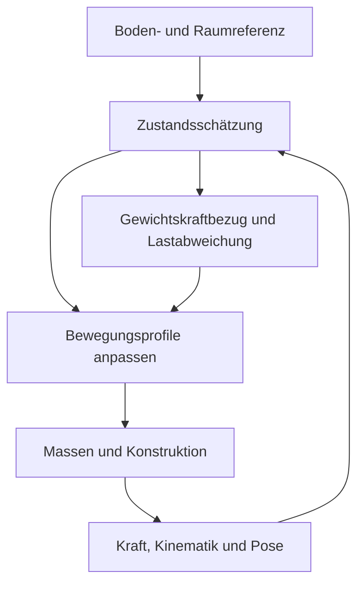

# PCMMS – Schwerkraftbezogene Messung und lageadaptive Bewegungsführung

Version 0.1 · 31.10.2026 · Konzeptentwurf einer Mess- und Führungsoption

Projekt und Autor: Phase-Controlled Multi-Mass Systems (PCMMS), Matthias Früh

Status: Konzeptentwurf, methodisch; keine ausgeführte Regelung, Simulation oder Messung dieser Option. Messunsicherheit, Bandbreite und erreichbare Regelgüte sind noch festzulegen.
Lizenz: CC BY 4.0, siehe [`../../LICENSE-CC-BY-4.0`](../../LICENSE-CC-BY-4.0). Namensnennung: „Matthias Früh, PCMMS“.

> **Einpflegevermerk (31.10.2026).** Grundlage ist der Quelldraft `PCMMS_Messoption_Schwerkraftbezug_Lageadaptive_Fuehrung_v0_1_2026-10-31.md` des Autors. Vor der Einpflege wurde er mit dem [Konzeptentwurf Massenkonzentration](massenkonzentration_v0_1_2026-10-31.md), der [Anforderungsspezifikation Dual-Armführung v0.4](anforderungsspezifikation_dual_armfuehrung_v0_4_2026-10-29.md) einschließlich AF-21, dem [Formelverzeichnis v2.8](../formelverzeichnis/README.md), dem [Anwendungsstrang Lageregelung](anwendungsstrang_lageregelung_2026-06.md) und, zur M-Konvention, der [Präregistrierung v2](../praeregistrierung_v2_entwurf.md) abgeglichen. Korrigiert, präzisiert oder ergänzt sind:
> - Systemgrenze (Abschnitte 2 und 3): Lage von L1 und Sensoraufsätzen je Versuch nach AF-01, externe Referenzen außerhalb von M, Leitungen nach AF-02, F_c als Kraft an der Grenze des bilanzierten Systems, Hinweis auf die M-Konvention (AF-31; Präregistrierung v2, Konvention (b)) ohne Festlegung.
> - Lastreferenz Mg − F_ext,z: Vorzeichentabelle (Abschnitt 3), korrigierter Beschleunigungsbeitrag und Rechenbeispiel mit der Lastreferenz 98 N bei +2 N äußerer Kraft (Abschnitt 4).
> - Live-Abzug (Abschnitt 4): Er setzt am kalibrierten Messkanal F_N an (Formelverzeichnis: F_c physikalische Kontaktkraft, F_N kalibriertes Signal). y_W ist als abgeleiteter Anzeigekanal gekennzeichnet. Die Nullmessung liefert F̂_base und prüft die Referenzbeiträge nur gemeinsam. Ŵ_0 fällt im zentrierten Vergleich nach AF-21 heraus.
> - Räumlicher Bezug (Abschnitte 5 und 6): statischer Momentenbezug zur Mehrkanalnotation und Inhalt einer Abweichung davon im Betrieb, Starrkörper-Hebelarmbeziehung und Montagerotation der IMU, Einführung der IMU-Symbole, Kontaktzustand unabhängig vom Kraftsignal nach AF-22.
> - Betriebsarten (Abschnitt 7): Übergänge außerhalb der Vergleichsfenster; die Betriebsart gehört zum Regelmodus und damit zur Zustandsbeschreibung (Formelverzeichnis v2.8, „Standardzustände und Kontrollen“; AF-16).
> - Querbezüge auf Formelverzeichnis v2.8 Gl. 4 und 6. Quellenzuordnung zu [2] und [4] präzisiert; [3] war bei der Einpflege nicht abrufbar und ist daher nicht erneut geprüft.
>
> Zur Vermeidung von Symbolkollisionen sind gegenüber dem Quelldraft umbenannt:
> - Laborsystem W → I (W_0 bleibt der Gewichtskraftbezug; I ist hier nicht das Trägheitsmoment);
> - λ → ξ_W (λ bzw. Λ ist der Liftoff-Anteil);
> - r_F → δF_W und κ_z → δF_W/Ŵ_0 (κ ist im Formelverzeichnis das Quantil, δF die Abweichung gegen F̂_base);
> - S_z → S_true;
> - Körperindex i und z_{G_i} → k und z_k (i ist der Abtastindex; k hier in Erweiterung des Formelverzeichnisses über alle Teilkörper);
> - q_k^* → u_k mit Grundprofil u_k^(G) (q_k ist im Formelverzeichnis die relative Modulkoordinate, q im Anwendungsstrang Lageregelung die Quaternion);
> - IMU-Rauschen n_a → η_a (n ist im Formelverzeichnis die Modulzahl).
>
> Rotationsmatrizen sind in den Formeln fett gesetzt, die Transposition als ⊤. Formelblöcke stehen als `$$`-Blöcke. Projektquellen sind relativ verlinkt, die Herkunftsangaben öffentlich formuliert. Messgenauigkeiten, Grenzwerte, Reglerparameter oder Ergebnisse sind nicht ergänzt. Die Anforderungen der Dual-Arm-Spezifikation werden durch diesen Entwurf nicht geändert.

## 1. Ziel und Funktion

**Die innere Massenbewegung soll gezielt relativ zur Schwerkraftrichtung oder zu einer anderen festgelegten Raumrichtung geführt werden können. Gleichzeitig werden Gewichtskraftbezug, aktuelle Lastabweichung sowie Position und Orientierung der Konstruktion laufend bestimmt. Diese Informationen dienen dazu, nachfolgende Bewegungsprofile nachvollziehbar anzupassen und Messvergleiche durchzuführen.**

Der vom Autor vorgeschlagene anteilige Live-Abzug von Mg wird als einstellbare rechnerische Gewichtskraftkompensation ausgearbeitet. Die räumliche Lage und Position erhalten einen eigenen Messbezug. Die Messgrößen werden anschließend gemeinsam in einer Zustandsschätzung genutzt.

„Permanent aktuell“ bedeutet hier: Schätzwerte mit Zeitstempel, bekannter Aktualisierungsrate, Latenz und Unsicherheit. Ein geeigneter Beobachter kann zwischen Messzeitpunkten vorhersagen; die Vorhersage bleibt als solche gekennzeichnet. Ziel ist eine für die Mess- und Führungsaufgabe ausreichend genaue Kenntnis des Zustands.

Als erste Ausprägung wird eine vertikale, geführte Anordnung mit Kraft- und Wegmessung betrachtet. Die räumliche Erweiterung wird gesondert ausgewiesen. Es wird weder eine bestimmte Armkinematik noch eine frei regelbare Position der gesamten Konstruktion vorausgesetzt.

## 2. Bezugssysteme, Richtungen und Massengrenze

| Größe | Bedeutung |
| --- | --- |
| I | Laborbezugssystem, wie im Formelverzeichnis v2.8 näherungsweise inertial, mit festem Referenzpunkt und z-Achse nach oben (Hoch- bzw. Tiefindex; nicht das Trägheitsmoment I bzw. der Trägheitstensor des Formelverzeichnisses) |
| B | Mit dem Träger L1 verbundenes Koordinatensystem (Hochindex; nicht zu verwechseln mit der Massengruppe M_B) |
| O | Markierter, trägerfester Bezugspunkt, dessen Position verfolgt wird; zugleich Bezugspunkt der Momente |
| p_O^I, R_IB | Position von O im Labor und Orientierung des Trägers als Rotationsmatrix; R_IB bildet B-Koordinaten nach I ab. Das Symbol q ist im Anwendungsstrang Lageregelung für die Quaternion vergeben und wird hier nicht für die Orientierung verwendet |
| e_g^I = −e_z^I, g^I = −g e_z^I | Einheitsvektor der örtlichen Schwerkraftrichtung nach unten und Schwerebeschleunigung als Vektor; g > 0 ist ihr Betrag |
| M | Tatsächliche materielle Gesamtmasse innerhalb der festgelegten Systemgrenze |
| W_0 = Mg | Betrag des Gewichtskraftbezugs; g wird als örtliche Referenz verwendet |
| k = 0 … n | Teilkörperindex in Erweiterung des Formelverzeichnisses v2.8 (dort k = 1 … n Module): k = 0 wie dort der übrige Körper bzw. Rahmen, bei L1 innerhalb von M der Träger mit seinen trägerfesten Teilen; k = 1 … n die übrigen Teilkörper innerhalb der Systemgrenze (Hauptmassen, Arme, Antriebsteile, mitbewegte Sensoraufsätze). n ist hier deren Anzahl und nicht zwingend die Modulzahl; i bleibt Abtastindex |
| m_k, z_k, r_k^B | Masse des Teilkörpers k, absolute vertikale Schwerpunktkoordinate im Laborsystem und Schwerpunktlage relativ zu O in B-Koordinaten |
| S | Gesamtschwerpunkt aller Teilkörper innerhalb der Systemgrenze (Index S wie in z_S des Formelverzeichnisses) |
| Ω | Drehrate des Trägers; ω bleibt die Kreisfrequenz der Anregung |

Für die erste vertikale Anordnung ist der Boden horizontal. Bei geneigtem Untergrund werden Bodennormale und Lotrichtung separat geführt. Eine einzelne Sensorrichtung kann ebenfalls von beiden abweichen.

Die Massenteilung folgt dem [Konzept zur Massenkonzentration](massenkonzentration_v0_1_2026-10-31.md): M = M_H + M_B + M_T. Ob der Träger L1 und welche Sensoraufsätze innerhalb von M liegen, wird nach AF-01 je Versuch festgelegt. Mitgetragene Sensoren der Messoption (IMU, Marker), ihre Halter und Leitungen gehören dann zu M und werden ihrer tatsächlichen Funktionsgruppe zugeordnet. Externe Referenzen wie optische Messung oder Abstandskanäle am Labor liegen außerhalb von M; Leitungen zwischen Labor und Körper sind Kraftpfade nach AF-02. Nach Materialwechsel, Massenentnahme oder Ergänzung werden M, Schwerpunkt- und Trägheitsdaten aktualisiert. Auftrieb geht in die äußeren Kräfte ein; eine hydrodynamisch zugesetzte Masse ist ein Dynamikparameter und wird nicht ungeprüft als zusätzliche materielle Gewichtskraft behandelt. Die M-Konvention wird je Versuch angegeben (vgl. AF-01; zur Hülle AF-31). Für Messungen nach der [Präregistrierung v2](../praeregistrierung_v2_entwurf.md) (§12, „Bestimmung von M“; [Anhang](../praeregistrierung_v2_anhang.md) A1) gilt deren vorläufige Arbeitsfestlegung Konvention (b): Mg ist dort die statische Last bei P0.2 einschließlich Auftrieb und gleichbleibender äußerer Kräfte; Ŵ_0 enthielte dann diese Beiträge und F_ext,z nur Abweichungen davon. Die Definitionen dieses Entwurfs (M als materielle Masse, Auftrieb in F_ext,z) entsprechen dieser Arbeitsfestlegung nicht unmittelbar; welche Konvention für Messungen mit dieser Option gilt, ist offen.

Der trägerfeste Punkt O und der veränderliche Gesamtschwerpunkt S werden unterschieden:

$$
\mathbf p_S^I
=\mathbf p_O^I+\mathbf R_{IB}\mathbf r_S^B,
\qquad
\mathbf r_S^B=\frac{1}{M}\sum_{k=0}^{n}m_k\mathbf r_k^B.
$$

Auch bei ruhendem Träger kann sich S aufgrund der inneren Bewegung verlagern. Diese Schwerpunktbildung entspricht der üblichen Mehrkörperbeschreibung [1].

## 3. Richtungsbetonte Bewegung und tatsächliche Lastwirkung

Für die vertikale Einzelauflage gilt mit z nach oben (Formelverzeichnis v2.8, Gl. 4; Dual-Arm-Spezifikation, Abschnitt 2):

$$
F_c(t)=Mg+S_{\mathrm{true}}(t)-F_{\mathrm{ext},z}(t),
\qquad
S_{\mathrm{true}}(t)=\sum_{k=0}^{n}m_k\ddot z_k(t).
$$

F_c ist die nach oben gerichtete Kontaktresultierende auf das bilanzierte System der Masse M an seiner Auflage (Formelverzeichnis v2.8); das System übt die entgegengesetzte Kraft auf die Auflage aus. Liegt der Träger L1 außerhalb von M, ist dies die Kraft an der Schnittstelle zwischen L1 und M; eine Kraftmessung unter L1 enthält dann zusätzlich dessen Gewicht und den Kraftbeitrag seiner Beschleunigung. F_ext,z enthält weitere äußere Kräfte mit positivem Vorzeichen nach oben. Die Summe umfasst alle Teilkörper; bei bewegtem oder kippendem Träger innerhalb von M gehört dessen Bewegung dazu.

Lastreferenz ist Mg − F_ext,z; ohne weitere äußere Kräfte ist sie Mg. Zu jedem Zeitpunkt gilt F_c − (Mg − F_ext,z) = S_true. Bei ruhendem Träger stammt S_true allein aus der Bewegung der inneren Teilkörper:

| Beschleunigung der inneren Massen, massengewichtet summiert | Kontaktkraft gegenüber der Lastreferenz Mg − F_ext,z |
| --- | --- |
| Nach unten: S_true < 0 | Entlastung, F_c < Mg − F_ext,z |
| Nach oben: S_true > 0 | Mehrbelastung, F_c > Mg − F_ext,z |

Die Tabelle beschreibt die zusätzliche dynamische Änderung. Ändern sich die weiteren äußeren Kräfte zeitlich, ändert sich die Lastreferenz mit; ein Vergleich gegen Mg allein enthält dann auch −F_ext,z.

Bewegungsrichtung, Geschwindigkeitsrichtung und Beschleunigungsrichtung sind getrennte Größen. Eine nach unten fahrende Masse kann während des Abbremsens nach oben beschleunigen. Für die momentane Lastwirkung ist die Beschleunigung maßgeblich.

Daraus ergeben sich drei mögliche Führungsziele, die je Versuch eindeutig benannt werden:

1. Eine Schwerpunktbahn der Hauptmassen mit betontem Abschnitt in Lotrichtung.
2. Eine bestimmte Reaktion der Massenführung auf den Träger.
3. Eine bestimmte gemessene Kontaktkraft-Wellenform, etwa definierte Entlastungs- oder Belastungsabschnitte.

Eine gerichtete Zusatzbewegung benötigt eine erreichbare Rückführung innerhalb des Arbeitsraums. Für einen periodischen, stationären Gesamtzustand ohne mittlere weitere Vertikalkraft und mit verschwindendem Impulsrandterm bleibt ⟨F_c⟩ = Mg (Formelverzeichnis v2.8, Gl. 6). Untersucht werden die zeitliche Verteilung und die Reproduzierbarkeit der Lastwirkung. Während Anlauf, Anpassung oder Kontaktzustandswechseln wird die vollständige Fensterbilanz verwendet.

Bei Kontaktverlust gilt das Flug-/Kontaktmodell. Die Kontaktkraft der Einzelauflage bleibt dann null; eine rechnerisch negative Kraft aus einer weiterhin erzwungenen Kontaktannahme ist keine zulässige Fortsetzung des Modells.

## 4. Einstellbarer Live-Abzug des Gewichtskraftbezugs

Für den kalibrierten vertikalen Summenkanal F_N (Schätzung von F_c über die reale Messkette) wird vorgeschlagen:

$$
y_W(t)=F_N(t)-\xi_W(t)\,\widehat W_0(t),
\qquad
0\leq\xi_W\leq1,
\qquad
\widehat W_0=\widehat M\widehat g.
$$

| Einstellung | Bedeutung |
| --- | --- |
| ξ_W = 0 | Unveränderter kalibrierter Kraftkanal |
| 0 < ξ_W < 1 | Teilweise rechnerische Kompensation; ein bekannter Grundlastanteil bleibt enthalten |
| ξ_W = 1 | Vollständiger rechnerischer Abzug des Gewichtskraftbezugs |

ξ_W ist ein Auswerteparameter. Er beschreibt keine physikalische Verminderung der Gewichtskraft und wird von Reglerverstärkungen getrennt geführt. y_W ist ein abgeleiteter Anzeigekanal und kein zusätzlicher Messkanal. Rohsignal und Kalibrierinformationen bleiben erhalten. Bei veränderlichem ξ_W wird dessen Zeitverlauf protokolliert; dadurch verursachte Signaländerungen werden nicht als Änderung der Mechanik gewertet.

Für die eigentliche Lastabweichung wird unabhängig von der Anzeigequote der vollständige Bezug verwendet:

$$
\delta F_W(t)=F_N(t)-\widehat W_0(t),
\qquad
\frac{\delta F_W(t)}{\widehat W_0(t)}.
$$

Der Quotient zeigt die aktuelle relative Abweichung vom Gewichtskraftbezug. Anders als δF im Formelverzeichnis, das gegen den gemessenen Referenzmittelwert F̂_base gebildet wird, bezieht sich δF_W auf den modellgestützten Bezug Ŵ_0. Bei genau bekanntem W_0 und idealer Messkette (F_N = F_c) gilt δF_W = S_true − F_ext,z. Somit enthält δF_W auch Auftrieb, Medienkräfte, Kabelkräfte und andere äußere Einflüsse. Erst nach deren getrennter Bestimmung darf der entsprechend korrigierte Wert dem Beschleunigungsbeitrag zugeordnet werden; er ist die Abweichung von der Lastreferenz Mg − F_ext,z:

$$
\widehat S_{\mathrm{true}}^{(F)}
=F_N-\widehat W_0+\widehat F_{\mathrm{ext},z}.
$$

Ein unabhängiger Kinematikpfad liefert:

$$
\widehat S_{\mathrm{true}}^{(\mathrm{kin})}
=\sum_{k=0}^{n}\widehat m_k\,\widehat{\ddot z}_k,
\qquad
r_{\mathrm{Bilanz}}
=F_N-\widehat W_0-\widehat S_{\mathrm{true}}^{(\mathrm{kin})}
+\widehat F_{\mathrm{ext},z}.
$$

Das Bilanzresiduum enthält verbleibende Modell-, Messketten-, Zeitzuordnungs- und Referenzfehler sowie nicht erfasste Kräfte. Im zentrierten Vergleich nach AF-21 fallen der konstante Bezug Ŵ_0 und konstante Anteile der äußeren Kräfte heraus; dieser Vergleich bleibt für dafür geeignete, dokumentierte Auswertefenster erhalten. Der vollständige Live-Vergleich ist nur unter entsprechend belegten Bedingungen ein Nulltest.

### Rechenbeispiel für die Anzeige

Angenommen sind W_0 = 100 N und ein kalibrierter Kraftwert von 108 N bei idealer Messkette. Die Zahlen sind reine Rechenwerte:

| Größe | Ergebnis |
| --- | ---: |
| Kalibrierter Kraftwert F_N (ξ_W = 0) | 108 N |
| Teilkompensation ξ_W = 0,8: y_W | 28 N |
| Darin verbliebener Gewichtskraftbezug | 20 N |
| Vollständige Lastabweichung δF_W | +8 N |
| Relative Lastabweichung δF_W/Ŵ_0 | +8 % |

Die 28 N der Teilkompensation sind daher nicht mit einem isolierten dynamischen Anteil gleichzusetzen. Falls zusätzlich eine äußere Vertikalkraft von +2 N bekannt wäre, betrüge die Lastreferenz 98 N, und es ergäbe sich S_true = 108 − 100 + 2 = 10 N.

### Referenzbestimmung und Filterung

M wird aus dem dokumentierten Aufbau bestimmt; g und die Ausrichtung werden als Referenz kalibriert. Eine Nullmessung ohne innere Bewegung liefert den gemessenen Referenzmittelwert F̂_base und prüft damit Ŵ_0, den Kraftbezug und die vorhandenen äußeren Kräfte gemeinsam; die Differenz F̂_base − Ŵ_0 ist ohne weitere Kontrollen keiner einzelnen Ursache zuzuordnen (Formelverzeichnis v2.8, „Theoretische und operative Basislinie“). Die laufende Kontaktkraft wird nicht ungeprüft als momentaner Schätzer für Mg benutzt: Sonst würden langsame Nutzsignalanteile oder äußere Kräfte in die Referenz übernommen.

Die Gewichtskraftkompensation erfolgt bevorzugt durch modellgestützten Referenzabzug. Ein pauschaler Hochpass trennt langsame Dynamik, Schwerkraftprojektion und Drift nicht eindeutig. Für jede zusätzliche Filterung sind Amplituden- und Phasenverhalten, Verzögerung und gültiges Frequenzband zu dokumentieren. Eine intern bereits schwerkraftbereinigte IMU-Ausgabe wird nicht nochmals mit derselben Korrektur beaufschlagt.

## 5. Räumliche Gewichtskraft und Momentenbezug

Bei räumlicher Bewegung gilt:

$$
\widehat{\mathbf F}_g^I
=-\widehat W_0\mathbf e_z^I,
\qquad
\widehat{\mathbf F}_g^B
=\widehat{\mathbf R}_{IB}^{\top}\widehat{\mathbf F}_g^I.
$$

Die Referenz wird in das jeweilige Messkoordinatensystem transformiert. Für einen idealen statischen Zustand ohne weitere äußere Kräfte ist die resultierende Stützkraft entgegengesetzt zur Gewichtskraft. Einzelne Zellkräfte ergeben sich erst aus Geometrie, Kraftrichtungen und Lastverteilung des Messaufbaus. Mg wird nicht von jedem Einzelkanal abgezogen.

Zusätzlich entsteht um den trägerfesten Punkt O ein Gewichtskraftmoment:

$$
\widehat{\boldsymbol\tau}_{g,O}^{B}
=\widehat{\mathbf r}_S^B
\times\widehat{\mathbf F}_g^B.
$$

Im idealen statischen Zustand ohne weitere äußere Kräfte und Momente gilt mit der Mehrkanalnotation des Formelverzeichnisses v2.8 (Resultierende F_Σ und Moment τ_O der Interfacekräfte um O), jeweils im selben Koordinatensystem: F_Σ = −F_g und τ_O = −τ_g,O. Außerhalb des statischen Zustands enthält die Abweichung von diesem Momentenbezug zusätzlich die Momentenwirkung der beschleunigten Teilkörper, darunter die dynamischen Kippmomente nach AF-07, sowie weitere äußere Momente; sie ist wie δF_W in Abschnitt 4 kein reiner Referenz- oder Messfehler.

Dieser Bezug kann sich durch Schwerpunktverlagerung der Innenmassen ändern, obwohl der Betrag Mg gleich bleibt. Eine räumliche Messoption berücksichtigt deshalb Kraft- und Momentenbezug. Ein Momentenkanal wird nur verwendet, wenn die gewählte Sensoranordnung ihn nachweislich rekonstruieren kann. Eine größere Kanalzahl allein belegt diese Beobachtbarkeit nicht.

Die Kraftbilanz ist additiv. Die Übertragung von kommandierter Profiländerung auf tatsächliche Kräfte kann durch Kinematik, elastische Kopplungen und einseitigen Kontakt dennoch nichtlinear sein. Überlagerte Sollbewegungen werden deshalb im vollständigen Modell geprüft.

## 6. Position und Orientierung aus einem eigenen Messbezug

Aus F_c − Mg folgt keine eindeutige absolute Position oder vollständige Orientierung. Der Live-Abzug ist ein Lastkanal. Für den räumlichen Zustand wird ein eigener Messpfad benötigt.

| Ausprägung | Messmittel und erfasste Größen |
| --- | --- |
| Vertikal und geführt | Kraftmessung; externer Weg-/Abstandskanal zum Punkt O; Kinematikmessung der Massen und Arme; Orientierungsüberwachung soweit die Führung Winkel nicht hinreichend festlegt |
| Räumlich beweglich | Kalibrierte externe Positions- und Orientierungsreferenz, beispielsweise optische Mehrpunktmessung; IMU für schnelle Drehraten und Beschleunigungsinformation; interne Kinematikkanäle; dazu geeignete Kraft-/gegebenenfalls Momentenkanäle |

Die externe Geometrie muss die benötigten Freiheitsgrade eindeutig erfassen. Ein einzelner Abstandskanal liefert zunächst nur die zugehörige Abstandsinformation. Der Schwerkraftvektor liefert unter geeigneten Bedingungen zwei Neigungsinformationen; die Drehung um die Lotachse benötigt eine zusätzliche Referenz [2].

### IMU-Modell und Trennung von Schwerkraft und Bewegung

Für eine trägerfest montierte IMU am Punkt P, deren Achsen mit B ausgerichtet sind, gilt in der hier verwendeten Konvention (sonst kommt die konstante Montagerotation hinzu):

$$
\widetilde{\mathbf f}^{B}
=\mathbf R_{IB}^{\top}\left(\mathbf a_P^I-\mathbf g^I\right)
+\mathbf b_a+\boldsymbol\eta_a.
$$

Dabei sind f̃^B die gemessene spezifische Kraft in B-Koordinaten, a_P^I die Beschleunigung von P im Laborsystem, b_a ein Bias und η_a das Messrauschen, entsprechend der Schreibweise y = H_cal w_O + b + η_y des Formelverzeichnisses. Die IMU misst spezifische Kraft. Ein ruhender Sensor mit nach oben gerichteter z-Achse zeigt ideal +g; bei freiem Fall ideal null. Rohwert und bereits verarbeitete Herstellerkanäle werden unterschieden [2]. Zur Rekonstruktion der Bewegung werden Orientierung und Schwerkraftreferenz gemeinsam verwendet.

Während Beschleunigung oder Rotation ist eine einfache Neigungsbestimmung aus dem momentanen Beschleunigungsvektor verfälscht; die statische Lotannahme allein genügt dann nicht [3]. Für P außerhalb von O werden die rotatorischen Hebelarmbeschleunigungen berücksichtigt; für einen trägerfesten Punkt P mit dem Hebelarm r_OP von O nach P und der Beschleunigung a_O von O gilt die Starrkörperbeziehung

$$
\mathbf a_P^I=\mathbf a_O^I+\dot{\boldsymbol\Omega}^I\times\mathbf r_{OP}^I
+\boldsymbol\Omega^I\times\left(\boldsymbol\Omega^I\times\mathbf r_{OP}^I\right),
\qquad
\mathbf r_{OP}^I=\mathbf R_{IB}\,\mathbf r_{OP}^B.
$$

Der bewegliche Gesamtschwerpunkt ist zusätzlich aus der inneren Kinematik zu bestimmen; die Beschleunigung eines IMU-Montagepunkts ist nicht automatisch die Beschleunigung von S.

Die Kombination aus IMU, externem Bezug und internem Bewegungsmodell bildet einen Zustandsbeobachter. Als Zustand kommen Position, Geschwindigkeit, Orientierung, Drehrate, Sensorbias, tatsächliche Modulkinematik und Kontaktzustand infrage. Der Kontaktzustand wird nach AF-22 unabhängig vom Kraftsignal erkannt (Kontakt-, Weg- oder Kinematikkanal). Reine doppelte Beschleunigungsintegration ohne Stützung akkumuliert Fehler [4]; externe Referenzen dienen der Begrenzung dieses Drifts. Ein konkreter Filter, etwa ein erweiterter Kalman-Filter, ist eine spätere Implementierungswahl und noch nicht ausgelegt.

## 7. Rückführung in die Bewegungsprofile

Der Beobachter stellt die aktuelle Richtung des Lots im Trägerrahmen, die Position und Orientierung des Trägers, die tatsächlichen Massenbahnen und den Kontaktzustand bereit. Daraus werden zulässige Änderungen des Folgeprofils berechnet.

Mögliche Stellgrößen sind Phase, Hub, Grundfrequenz, Profilform und – sofern die Kinematik es erlaubt – räumliche Bahnorientierung. Eine schematische Sollüberlagerung lautet für die Führung der Hauptmasse k:

$$
\mathbf u_k(t)=\mathbf u_k^{(\mathrm G)}(t)+\delta\mathbf u_k(t).
$$

Hier bezeichnet u_k den Sollwert geeigneter Gelenk- oder Profilkoordinaten der Führung von Masse k; für einen relativen Positionssollwert entspricht er u_q,k des Formelverzeichnisses v2.8 (Abschnitt „Profil, Amplitude und Phase“). u_k^(G) ist das vorgegebene Grundprofil, δu_k dessen Anpassung bzw. das Zusatzprofil (vgl. Abschnitt 8, Schritt 5); δu_k ist keine zusätzliche frei verfügbare Bewegung. Die Zusatzbewegung muss zur Kinematik passen. Bei der Dual-Armführung werden die geschlossene Schleife und die Lastaufteilung berücksichtigt. Änderungen von Phase und Profil werden mit ihren Geschwindigkeits- und Beschleunigungsfolgen glatt überführt; Arbeitsraum, Ruck, Antriebsmomente, Kontakt und Strukturbelastung bleiben im Modell enthalten.

Die Sollrichtung wird im Laborbezug festgelegt und für den aktuellen Trägerzustand in die Armkinematik umgesetzt. Bei bewegtem Bezugssystem gehören auch die zeitlichen Änderungen dieser Transformation in die Bahn- und Beschleunigungsberechnung.

Die Lageschätzung ermöglicht eine lageabhängige Führung der Innenmassen. Ob darüber hinaus Position oder Orientierung der gesamten Apparatur in einem gewünschten Bereich regelbar sind, hängt von erreichbaren Stellkräften/-momenten, Kontaktbedingungen und äußeren Kopplungen ab. Beobachtbarkeit und Regelbarkeit werden getrennt geprüft.

### Drei Betriebsarten

| Betriebsart | Zweck und Auswertung |
| --- | --- |
| Nur beobachten | Profile bleiben vorgegeben; der Beobachter berechnet Richtungen, Lastabweichung und Pose zur unabhängigen Gegenprüfung |
| Abschnittsweise anpassen | Profilparameter werden zu definierten Übergängen geändert und in den Vergleichsfenstern konstant gehalten; jedes Fenster besitzt einen dokumentierten Parametersatz; Übergänge und Einschwingvorgänge liegen außerhalb der Vergleichsfenster oder werden mit der vollständigen Fensterbilanz ausgewertet |
| Laufend adaptieren | Kontinuierliche Rückführung für Funktionstests; Änderungen und tatsächliche Bahnen werden vollständig protokolliert, der Lauf wird als nichtstationär ausgewertet |

Ein laufend adaptierter Versuch wird nicht ungeprüft mit einer stationären Phasenkarte oder einem Lauf mit eingefrorenen Profilen gleichgesetzt. Die Betriebsart gehört zum Regelmodus und damit zur Zustandsbeschreibung (Formelverzeichnis v2.8, „Standardzustände und Kontrollen“; AF-16). Die jeweilige Messfrage legt fest, welche Betriebsart geeignet ist.

## 8. Messvergleiche und schrittweise Prüfung

Die folgenden Punkte sind ein vorgeschlagener Prüfweg; sie wurden für diesen Entwurf nicht ausgeführt:

1. **Ruhereferenz:** Masse und Kraftbezug bestimmen, feste Pose/Nullposition erfassen; Einzelkanäle und Gesamtbilanz prüfen.
2. **Vorzeichenprüfung:** Bekannte vertikale Innenmassenbewegung mit ruhendem Träger; Kinematikbeitrag und Kontaktkraftänderung vergleichen.
3. **Bezugssystemprüfung:** Vorgegebene Neigungen und bekannte Positionsänderungen bei ruhenden Innenmassen; Gewichtskraftprojektion, Bezugspunkt und rekonstruierte Pose gegen die externe Referenz prüfen.
4. **Bewegter Träger:** Gleiche innere Profile bei zusätzlich bekannter Trägerbewegung; Rahmentranslation, Rotation und Sensorhebelarme im Modell berücksichtigen.
5. **Überlagerungsvergleich:** Grundprofil, Zusatzprofil und kombiniertes Profil messen beziehungsweise zunächst simulieren; bei Kontakt- oder Struktur-Nichtlinearität das kombinierte Ergebnis eigenständig auswerten.
6. **Adaptive Führung:** Beobachtungsbetrieb, abschnittsweise und laufende Anpassung bei dokumentierten Anfangszuständen und gleicher Messfrage vergleichen.
7. **Massen- und Kopplungsvarianten:** Geänderte Hauptmassen, Halter, Sensorbestückung oder Kopplungen nach dem [Konzept zur Massenkonzentration](massenkonzentration_v0_1_2026-10-31.md) vergleichen; Aufbau, Referenzen und Beobachtermodell jeweils nachführen.

Zu protokollieren sind mindestens: Rohkräfte, kalibrierte Summen-/Vektorkanäle, Referenzbetrag und ξ_W, interne Ist-Kinematik, externe Posemessung, IMU-Roh- beziehungsweise eindeutig bezeichnete verarbeitete Kanäle, geschätzter Zustand mit Güteangabe, Sollprofile und Änderungen, Zeitzuordnung sowie Kontaktzustandswechsel.

Die zusätzliche Aussagekraft des Beobachters wird gegen eine tatsächlich unabhängige Referenz bewertet. Eine bereits zum Beobachter gehörende Messung ist nicht zugleich seine unabhängige Validierung. Für die erste vertikale Ausprägung kann hierfür beispielsweise ein gesonderter Referenzwegkanal vorgesehen oder eine geeignete Prüfgeometrie verwendet werden.

## 9. Genauigkeit, Zeitverhalten und Auslegungsgrenzen

Die später festzulegenden Gütegrößen sind Positions- und Orientierungsfehler, Unsicherheit des Gewichtskraftbezugs, Fehler der Lastabweichung, Phasenfehler und Regelabweichung. Hinzu kommen Abtastung, nutzbare Bandbreite, Filterlaufzeit, Übertragungs- und Rechenlatenz sowie die Reaktion auf ausfallende oder unplausible Referenzdaten.

Alle Kanäle verwenden eine gemeinsame Zeitbasis oder eine bestimmte Zeittransformation. Größen werden für die Bilanz auf denselben Zeitpunkt bezogen. Für die Bewegungsvorgabe kann eine Vorhersage bis zum tatsächlichen Stellzeitpunkt notwendig sein. Messzeit, Schätzzeit und Stellzeit bleiben unterscheidbar.

Bei unzureichender Beobachtbarkeit oder überschrittener Schätzunsicherheit wird der Zustandswert als eingeschränkt gültig gekennzeichnet. Ob die Anpassung pausiert oder auf ein definiertes Profil übergeht, ist Teil der späteren Regelungsauslegung; dafür werden noch keine Grenzwerte oder Reglerparameter festgelegt.

Ein kleineres Kraftresiduum kann aus einer verbesserten Referenzierung entstehen. Daraus folgt allein keine bessere Positionserfassung. Ebenso belegt eine gute Poseerfassung noch keine genaue Trennung innerer Dynamik und unbekannter äußerer Kräfte. Beide Messaufgaben erhalten eigene Nachweise.

## 10. Anschluss an den PCMMS-Projektstand

- [Dual-Arm-Spezifikation v0.4](anforderungsspezifikation_dual_armfuehrung_v0_4_2026-10-29.md): AF-01/02 Systemgrenze und äußere Kräfte; AF-06 bis AF-09 Kinematik und Schwerpunkt; AF-12/16 glatte Profile und Übergänge; AF-17 bis AF-21 Zeitbasis, Kinematik und Bilanz; AF-22 Kontaktindikator; AF-23 bis AF-25 Belastung, Steifigkeit und Spiel.
- [Massenkonzentrationskonzept vom 31.10.2026](massenkonzentration_v0_1_2026-10-31.md): gemeinsame Bewertung von Hauptmassen, bewegter Nebenmasse, Sensorik und Kopplung; Rückführung geänderter Aufbauparameter in die Messmodelle.
- Vorhandener [Anwendungsstrang Lageregelung](anwendungsstrang_lageregelung_2026-06.md): thematischer Anschluss, jedoch kein Nachweis für die hier vorgeschlagene Mess- und Führungsoption. Die dort im Vermerk als nicht ausgeführt gekennzeichnete PCMMS-Regelung wird nicht als vorhandene Implementierung übernommen.
- Arbeitspakete: berührt AP-01, AP-04, AP-06, AP-07, AP-10 und bei räumlicher Erweiterung AP-27. Die bisherige Stufenfolge und die freien Architekturentscheidungen werden durch diesen Entwurf nicht geändert.

Offen sind insbesondere der benötigte Freiheitsgradumfang, die konkrete Referenzgeometrie, erreichbare Messunsicherheit und Bandbreite, Sensorbefestigung, unabhängige Prüfmittel, Behandlung weiterer äußerer Kräfte sowie Regelbarkeit und Parametergrenzen je Konstruktionsvariante.

## Quellen und Herkunft

- Projektquelle: [Anforderungsspezifikation Dual-Armführung v0.4 mit AF-21-Nachtrag](anforderungsspezifikation_dual_armfuehrung_v0_4_2026-10-29.md), am 31.10.2026 in der Fassung von `main` gelesen (Blob `5d2ba953898e9120054c38e2adb919630a16f0c0`); die Querverweise vom 31.10.2026 in Abschnitt 6 sind danach ergänzt.
- Projektquelle: [Anwendungsstrang Lageregelung einschließlich Vermerk vom 22.10.2026](anwendungsstrang_lageregelung_2026-06.md), am 31.10.2026 gelesen (Blob `4d59ae9237c7c78ff3ad719bab44ca51f5f6b5e8`).
- Projektquelle: [Konzeptentwurf Massenkonzentration v0.1 vom 31.10.2026](massenkonzentration_v0_1_2026-10-31.md), erweiterter Entwurf des Autors.
- Projektquelle: [Präregistrierung v2, Entwurf](../praeregistrierung_v2_entwurf.md), §12, Zeile „Bestimmung von M“, und [Anhang](../praeregistrierung_v2_anhang.md) A1: M-Konvention (b), am 31.10.2026 gelesen.
- Projektquelle: [Formelverzeichnis v2.8](../formelverzeichnis/README.md), Abschnitte „Vorzeichen und Bezugssystem“, „Indizes und Schreibweisen“, „Massen und Koordinaten“, „Kraftgrößen“, „Mehrpunkt-, Mehrinterface- und Mehrkanalmessung“, „Basislinie und Schwerpunktsatz“, „Modulations- und Steuerkonzepte“, „Allgemeine mechanische Grundbeziehungen“; Notationsabgleich bei der Einpflege.
- [1] Russ Tedrake, MIT: [Underactuated Robotics – Highly-articulated Legged Robots, Centroidal dynamics / Generalization to multibody](https://underactuated.mit.edu/humanoids.html), abgerufen am 31.10.2026.
- [2] Paul Bovbel, ROS: [REP 145 – Conventions for IMU Sensor Drivers](https://github.com/ros-infrastructure/rep/blob/master/rep-0145.rst), Entwurf; Abschnitte Frame Conventions, Data Reporting mit Data Sources sowie Topics, abgerufen am 31.10.2026.
- [3] Christopher J. Fisher, Analog Devices: [AN-1057 – Using an Accelerometer for Inclination Sensing](https://www.analog.com/en/resources/app-notes/an-1057.html), insbesondere die Annahmen der statischen Neigungsbestimmung; laut Quelldraft abgerufen am 31.10.2026, bei der Einpflege nicht erreichbar (HTTP 503) und daher nicht erneut geprüft.
- [4] VectorNav: [What is an Inertial Navigation System?](https://www.vectornav.com/resources/detail/what-is-an-ins), Fehlerfortpflanzung und Lageabhängigkeit der Positionsintegration; abgerufen am 31.10.2026.

Die Zielrichtung, der anteilige Live-Abzug und die lageabhängige Anpassung stammen aus der Vorgabe des Autors. Signaldefinitionen, Messarchitektur und Prüfweg sind Vorschläge dieses Entwurfs. Quellen belegen die verwendeten mechanischen und messtechnischen Grundlagen, keine bereits erreichte PCMMS-Regelgüte.
